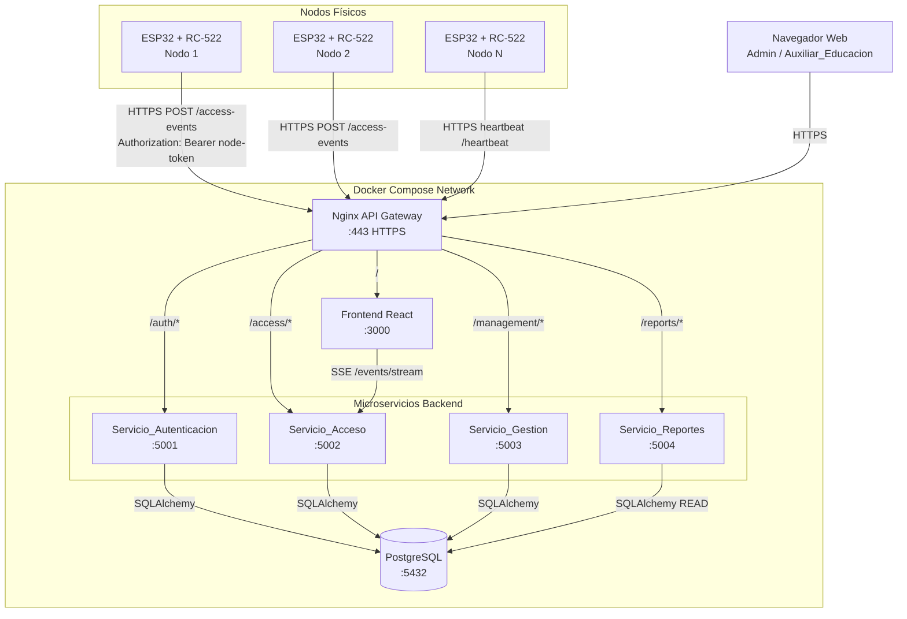
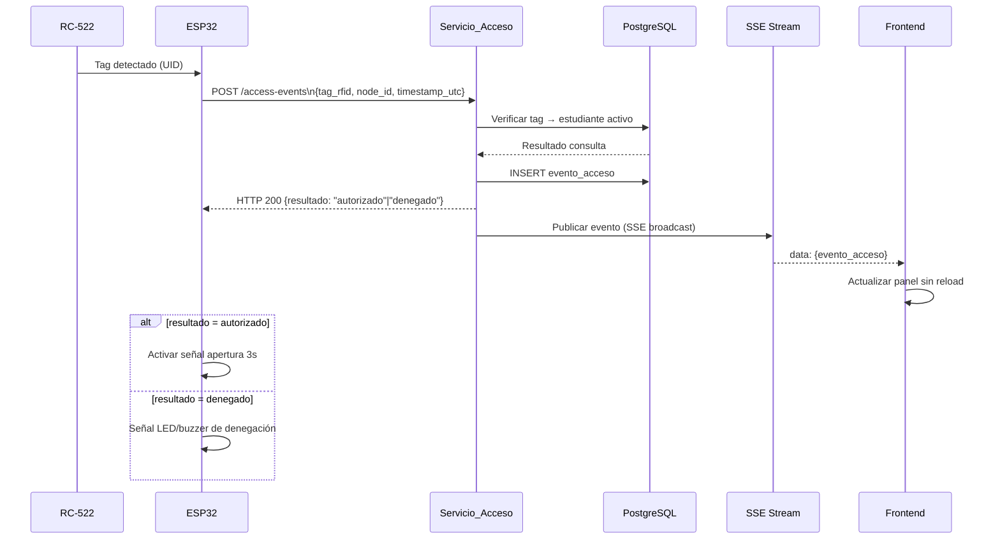
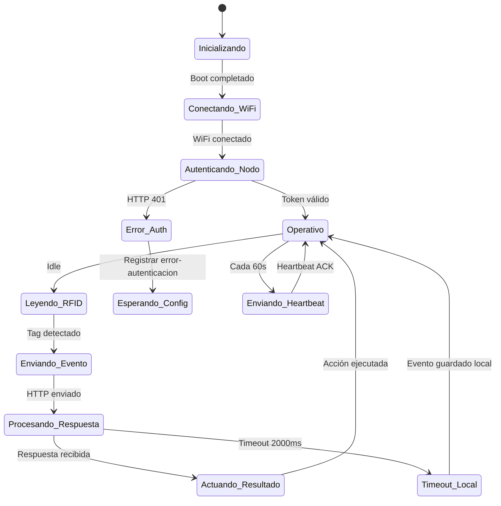
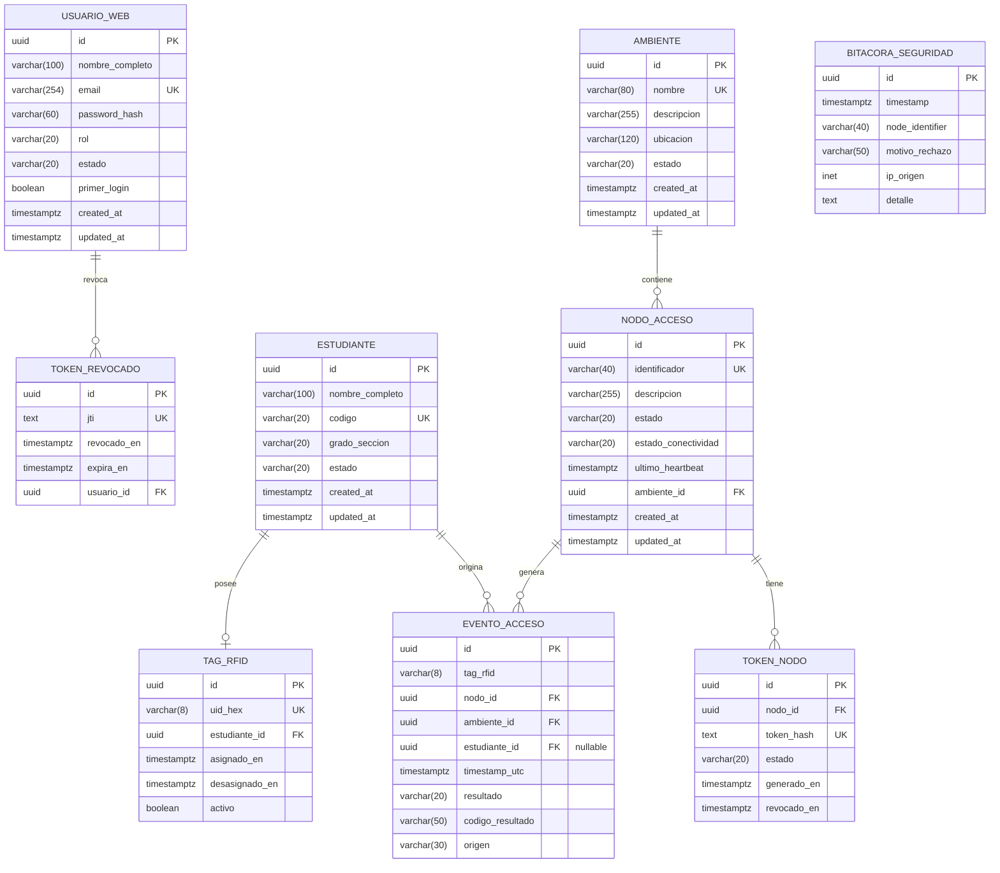

# Design Document

## Overview

El sistema IoT de Control de Acceso RFID es una plataforma distribuida para gestionar y monitorear el ingreso de estudiantes a ambientes educativos. Combina hardware embebido (ESP32 + RC-522) con un backend de microservicios Python/Flask, una base de datos PostgreSQL y un frontend React.js/Vite.

### Objetivos de diseño

- **Baja latencia**: Respuesta del nodo físico en menos de 1000 ms para no interrumpir el flujo de estudiantes.
- **Tiempo real**: Los eventos de acceso deben reflejarse en el dashboard de monitoreo en menos de 3 segundos.
- **Seguridad en capas**: Autenticación JWT para usuarios web, tokens de nodo para ESP32, TLS para todas las comunicaciones externas.
- **Resiliencia**: Operación local del ESP32 ante pérdida de conectividad; recuperación automática de microservicios.
- **Despliegue reproducible**: Cada componente empaquetado en Docker, orquestado con Docker Compose.

### Tecnologías clave

| Capa | Tecnología |
|------|-----------|
| Nodo físico | ESP32 (Arduino/ESP-IDF), RC-522 (MFRC522 lib) |
| Backend | Python 3.11, Flask, Flask-JWT-Extended, SQLAlchemy, Gunicorn |
| Base de datos | PostgreSQL 15 |
| Frontend | React.js 18, Vite, Axios, EventSource API |
| Mensajería tiempo real | Server-Sent Events (SSE) |
| Contenedores | Docker, Docker Compose v2 |

---

## Architecture

El sistema sigue una arquitectura de **microservicios desacoplados** con comunicación HTTP/REST. Los nodos ESP32 se comunican directamente con el Servicio_Acceso. El frontend consume todos los microservicios a través de un API Gateway Nginx (reverse proxy). La comunicación en tiempo real usa SSE (Server-Sent Events) por ser unidireccional servidor→cliente, sin requerir WebSocket bidireccional completo.



### Flujo principal de acceso



---

## Components and Interfaces

### Servicio_Autenticacion (puerto 5001)

Responsable de gestionar la identidad de los usuarios web.

**Endpoints:**

| Método | Ruta | Descripción | Auth requerida |
|--------|------|-------------|----------------|
| POST | `/auth/login` | Valida credenciales, retorna JWT | No |
| POST | `/auth/logout` | Revoca el JWT activo del usuario | JWT |
| POST | `/auth/change-password` | Cambia contraseña (primer login o voluntario) | JWT |
| GET | `/auth/health` | Health check del servicio | No |

**Contrato login (POST /auth/login):**
```json
// Request
{ "email": "admin@escuela.pe", "password": "secreto123" }

// Response 200
{
  "token": "<JWT HS256>",
  "rol": "ADMINISTRADOR",
  "nombre": "Carlos Pérez",
  "primer_login": false
}

// Response 401
{ "error": "credenciales-invalidas" }
```

**Claims del JWT:**
```json
{
  "sub": "uuid-del-usuario",
  "rol": "ADMINISTRADOR",
  "nombre": "Carlos Pérez",
  "primer_login": false,
  "iat": 1700000000,
  "exp": 1700028800
}
```

---

### Servicio_Acceso (puerto 5002)

Núcleo del sistema IoT. Procesa eventos de acceso provenientes de los nodos ESP32 y publica actualizaciones SSE al frontend.

**Endpoints:**

| Método | Ruta | Descripción | Auth requerida |
|--------|------|-------------|----------------|
| POST | `/access/events` | Recibe evento RFID del ESP32 | Node Token |
| POST | `/access/heartbeat` | Recibe heartbeat del ESP32 | Node Token |
| GET | `/access/events` | Lista eventos (paginado) | JWT |
| GET | `/access/nodes/status` | Estado de conectividad de nodos | JWT |
| GET | `/access/events/stream` | Stream SSE de eventos en tiempo real | JWT |
| GET | `/access/health` | Health check del servicio | No |

**Contrato evento de acceso (POST /access/events):**
```json
// Request (desde ESP32)
{
  "tag_rfid": "A1B2C3D4",
  "node_id": "NODO-LAB-01",
  "timestamp_utc": "2024-01-15T08:30:00Z"
}

// Response 200
{
  "resultado": "autorizado",
  "codigo_resultado": null,
  "evento_id": "uuid-del-evento"
}

// Response 200 (denegado)
{
  "resultado": "denegado",
  "codigo_resultado": "estudiante-inactivo",
  "evento_id": "uuid-del-evento"
}

// Response 401 (token de nodo inválido)
{ "error": "token-nodo-invalido" }
```

**Stream SSE (GET /access/events/stream):**
```
Content-Type: text/event-stream
Cache-Control: no-cache

data: {"evento_id":"uuid","estudiante":"Ana García","ambiente":"Laboratorio A",
       "timestamp":"2024-01-15T08:30:00Z","resultado":"autorizado"}

data: {"tipo":"node_status","node_id":"NODO-LAB-01","estado":"sin-conexion"}
```

---

### Servicio_Gestion (puerto 5003)

Gestión CRUD de la configuración del sistema: estudiantes, ambientes, nodos y usuarios web.

**Endpoints principales:**

| Método | Ruta | Descripción | Rol requerido |
|--------|------|-------------|---------------|
| POST | `/management/students` | Crear estudiante | ADMINISTRADOR |
| GET | `/management/students` | Listar estudiantes | ADMINISTRADOR |
| PATCH | `/management/students/{id}` | Actualizar estudiante | ADMINISTRADOR |
| POST | `/management/students/{id}/rfid` | Asociar tag RFID | ADMINISTRADOR |
| POST | `/management/environments` | Crear ambiente | ADMINISTRADOR |
| GET | `/management/environments` | Listar ambientes | ADMINISTRADOR |
| POST | `/management/nodes` | Registrar nodo de acceso | ADMINISTRADOR |
| PATCH | `/management/nodes/{id}/status` | Habilitar/deshabilitar nodo | ADMINISTRADOR |
| POST | `/management/nodes/{id}/token` | Generar/revocar token de nodo | ADMINISTRADOR |
| POST | `/management/users` | Crear usuario web | ADMINISTRADOR |
| PATCH | `/management/users/{id}` | Modificar usuario web | ADMINISTRADOR |
| GET | `/management/health` | Health check del servicio | No |

---

### Servicio_Reportes (puerto 5004)

Consultas analíticas de solo lectura sobre los eventos de acceso.

**Endpoints:**

| Método | Ruta | Descripción | Rol requerido |
|--------|------|-------------|---------------|
| GET | `/reports/events` | Listado paginado de eventos | JWT |
| GET | `/reports/attendance-summary` | Resumen de asistencia por estudiante | JWT |
| GET | `/reports/health` | Health check del servicio | No |

**Parámetros GET /reports/events:**
```
fecha_inicio   (requerido, ISO 8601 date)
fecha_fin      (requerido, ISO 8601 date)
id_estudiante  (opcional, UUID)
id_ambiente    (opcional, UUID)
page           (opcional, entero ≥ 1, default 1)
page_size      (opcional, entero 1-100, default 50)
```

---

### Frontend React.js (puerto 3000)

SPA construida con React 18 + Vite. Consume la API REST y el stream SSE.

**Módulos principales:**

| Módulo | Ruta | Roles con acceso |
|--------|------|-----------------|
| Login | `/login` | Todos |
| Cambio de contraseña | `/change-password` | Todos (primer login) |
| Dashboard de monitoreo | `/dashboard` | ADMINISTRADOR, AUXILIAR_EDUCACION |
| Gestión de estudiantes | `/students` | ADMINISTRADOR |
| Gestión de ambientes | `/environments` | ADMINISTRADOR |
| Gestión de nodos | `/nodes` | ADMINISTRADOR |
| Gestión de usuarios | `/users` | ADMINISTRADOR |
| Reportes | `/reports` | ADMINISTRADOR |

**Lógica SSE en el cliente:**
```javascript
// Hook personalizado useAccessEvents
const eventSource = new EventSource('/access/events/stream', {
  headers: { Authorization: `Bearer ${jwt}` }
});
eventSource.onmessage = (e) => {
  const event = JSON.parse(e.data);
  dispatch(addAccessEvent(event)); // Redux / Zustand
};
```

---

### Firmware ESP32

El firmware implementa una máquina de estados para gestionar las operaciones del nodo.



**Configuración del firmware (almacenada en NVS/EEPROM):**
```c
typedef struct {
    char wifi_ssid[64];
    char wifi_password[64];
    char backend_url[128];   // https://api.escuela.pe
    char node_id[41];        // ID único del nodo
    char node_token[256];    // Bearer token del nodo
    uint16_t timeout_ms;     // 2000 ms
    uint8_t max_retries;     // 3
    uint16_t retry_interval_ms; // 5000 ms
    uint16_t heartbeat_interval_s; // 60 s
} NodeConfig;
```

---

## Data Models

### Diagrama Entidad-Relación



### Notas sobre el modelo

- **EVENTO_ACCESO.estudiante_id** es nullable: si el `tag_rfid` no está registrado, el evento se persiste con `estudiante_id = NULL` y `codigo_resultado = 'tag-no-registrado'`.
- **TAG_RFID** mantiene historial mediante `activo` y `desasignado_en`: un tag puede ser reasignado conservando el historial.
- **TOKEN_NODO** almacena el hash del token (no el token en texto claro) para verificación segura.
- **BITACORA_SEGURIDAD** es append-only; nunca se actualiza ni elimina.
- Los índices clave para rendimiento:
  - `EVENTO_ACCESO(timestamp_utc DESC)` — consultas de reportes
  - `EVENTO_ACCESO(nodo_id, timestamp_utc DESC)` — monitoreo por nodo
  - `EVENTO_ACCESO(estudiante_id, timestamp_utc DESC)` — reportes por estudiante
  - `TAG_RFID(uid_hex)` WHERE `activo = TRUE` — lookup rápido en acceso


---

## Correctness Properties

*Una propiedad es una característica o comportamiento que debe mantenerse verdadero en todas las ejecuciones válidas del sistema — esencialmente, una declaración formal sobre lo que el sistema debe hacer. Las propiedades sirven como puente entre las especificaciones legibles por humanos y las garantías de corrección verificables por máquina.*

### Property 1: Resultado de acceso determinado por estado del estudiante

*Para cualquier* evento de acceso enviado a un nodo activo, el resultado debe ser exactamente "autorizado" si y solo si el `tag_rfid` está asociado a un estudiante con estado "activo"; debe ser "denegado" con código "estudiante-inactivo" si el tag pertenece a un estudiante inactivo; y "denegado" con código "tag-no-registrado" si el tag no está en el sistema.

**Validates: Requirements 3.4, 3.5, 3.6**

---

### Property 2: Nodo inactivo deniega todos los accesos

*Para cualquier* tag RFID (registrado de estudiante activo, de estudiante inactivo, o no registrado) enviado a un nodo con estado "inactivo", el Servicio_Acceso siempre debe retornar resultado "denegado" con código "nodo-inactivo".

**Validates: Requirements 2.7**

---

### Property 3: Unicidad de identificadores clave

*Para cualquier* entidad (Estudiante con campo `codigo`, Ambiente con campo `nombre`, Usuario web con campo `email`) que ya exista en la base de datos, intentar crear otra entidad con el mismo identificador clave siempre debe retornar HTTP 409 con el código de error correspondiente ("codigo-duplicado", "nombre-ambiente-duplicado" o "email-duplicado" respectivamente).

**Validates: Requirements 1.3, 2.2, 7.2**

---

### Property 4: Unicidad y exclusividad del tag RFID

*Para cualquier* tag RFID que ya esté asignado a un estudiante (independientemente de si ese estudiante está activo o inactivo), intentar asignar el mismo tag a cualquier otro estudiante siempre debe retornar HTTP 409 con código "tag-en-uso".

**Validates: Requirements 1.4**

---

### Property 5: Actualización parcial preserva asociaciones

*Para cualquier* estudiante con un tag RFID asociado, aplicar una actualización parcial (PATCH) sobre cualquier subconjunto de campos modificables (nombre_completo, grado_seccion, estado) debe preservar la asociación del tag RFID sin modificarla.

**Validates: Requirements 1.7**

---

### Property 6: Desactivación preserva integridad histórica

*Para cualquier* estudiante o nodo de acceso con K eventos de acceso registrados, desactivar dicha entidad debe dejar exactamente K eventos inalterados; ningún evento debe ser eliminado, modificado ni ocultado como resultado de la operación de desactivación.

**Validates: Requirements 1.6, 2.6**

---

### Property 7: JWT válido contiene claims obligatorios y coherentes

*Para cualquier* usuario web activo que se autentique con credenciales correctas, el JWT retornado debe contener los claims `sub` (igual al ID del usuario), `rol` (igual al rol asignado al usuario), y `exp` (igual a timestamp de emisión + exactamente 8 horas); y el JWT debe ser verificable con la clave secreta del servidor.

**Validates: Requirements 4.1**

---

### Property 8: Credenciales incorrectas producen respuesta genérica

*Para cualquier* combinación de credenciales incorrectas (email no registrado, password incorrecto para email existente, o ambos), el Servicio_Autenticacion siempre debe retornar HTTP 401 con exactamente el mensaje "credenciales-invalidas", sin revelar en el cuerpo de la respuesta información sobre cuál campo falló.

**Validates: Requirements 4.2**

---

### Property 9: JWT inválido es rechazado por todos los endpoints protegidos

*Para cualquier* JWT que sea inválido (firma modificada, expirado, o cuyo jti se encuentre en la lista de tokens revocados), cualquier endpoint protegido del backend debe retornar HTTP 401 y no procesar la acción solicitada.

**Validates: Requirements 4.4**

---

### Property 10: Control de acceso basado en roles es consistente

*Para cualquier* usuario con rol "AUXILIAR_EDUCACION" que intente acceder a cualquier endpoint de creación, modificación o eliminación del Servicio_Gestion, la respuesta siempre debe ser HTTP 403. *Para cualquier* usuario con rol "ADMINISTRADOR", el acceso a todos los endpoints del Servicio_Gestion siempre debe estar permitido (HTTP 2xx).

**Validates: Requirements 4.5, 4.6, 4.7, 4.8**

---

### Property 11: Logout invalida el token para uso futuro

*Para cualquier* JWT activo y válido, hacer logout (que agrega el jti a la lista de revocados) debe hacer que cualquier uso posterior del mismo JWT en cualquier endpoint protegido retorne HTTP 401.

**Validates: Requirements 4.9**

---

### Property 12: Token de nodo revocado es rechazado y auditado sin persistir evento

*Para cualquier* solicitud de evento de acceso con un token de nodo ausente, malformado o revocado, el Servicio_Acceso debe: (a) retornar HTTP 401, (b) registrar una entrada en BITACORA_SEGURIDAD con timestamp y motivo, y (c) no crear ningún registro en EVENTO_ACCESO.

**Validates: Requirements 8.1, 8.2**

---

### Property 13: Persistencia completa de cada evento de acceso

*Para cualquier* evento de acceso procesado exitosamente por el Servicio_Acceso, al consultar ese evento en la base de datos debe contener valores no nulos en los campos: `id`, `tag_rfid`, `id_nodo`, `id_ambiente`, `timestamp_utc` y `resultado`; y el campo `codigo_resultado` debe ser nulo si y solo si el resultado es "autorizado".

**Validates: Requirements 3.8**

---

### Property 14: Reporte de eventos ordenado y paginado correctamente

*Para cualquier* consulta de reporte con rango de fechas válido (≤ 90 días), los registros retornados deben estar ordenados de más reciente a más antiguo (`timestamp_utc DESC`), y ninguna página debe contener más de 100 registros.

**Validates: Requirements 6.1**

---

### Property 15: Validación del rango máximo de fechas en reportes

*Para cualquier* par (fecha_inicio, fecha_fin) donde la diferencia supere 90 días calendario, el Servicio_Reportes debe retornar HTTP 400 con "rango-maximo-excedido". *Para cualquier* par donde la diferencia sea ≤ 90 días, no debe retornar ese error por esta razón.

**Validates: Requirements 6.4**

---

### Property 16: Resultado vacío y límite de resultados en reportes

*Para cualquier* filtro que no matchee ningún registro, el Servicio_Reportes debe retornar HTTP 200 con lista vacía y campo `total` igual a 0. *Para cualquier* filtro que matchee más de 10.000 registros, debe retornar HTTP 400 con "resultado-excede-limite".

**Validates: Requirements 6.6, 6.7**

---

### Property 17: Exportación CSV correctamente formateada

*Para cualquier* conjunto de N registros (1 ≤ N ≤ 10.000) del filtro activo, el archivo CSV generado debe tener exactamente N líneas de datos más 1 línea de cabecera, estar codificado en UTF-8 y usar coma como delimitador de campos.

**Validates: Requirements 6.3**

---

### Property 18: Filtros de monitoreo con lógica AND estricta

*Para cualquier* combinación de filtros simultáneos (Ambiente, fecha, resultado), todos y cada uno de los eventos retornados deben satisfacer simultáneamente todos los filtros aplicados.

**Validates: Requirements 5.3**

---

### Property 19: Desactivación de usuario web bloquea autenticación

*Para cualquier* usuario web con estado "inactivo", cualquier intento de inicio de sesión con cualquier contraseña (correcta o incorrecta) debe retornar HTTP 401.

**Validates: Requirements 7.4**

---

## Error Handling

### Estrategia general de errores

Todos los errores del backend siguen el mismo contrato de respuesta JSON:

```json
{
  "error": "<código-kebab-case>",
  "mensaje": "<descripción legible opcional>",
  "timestamp": "2024-01-15T08:30:00Z"
}
```

### Tabla de errores por servicio

| Servicio | Código HTTP | Campo `error` | Causa |
|----------|-------------|---------------|-------|
| Servicio_Gestion | 409 | `codigo-duplicado` | Código de estudiante ya existe |
| Servicio_Gestion | 409 | `tag-en-uso` | Tag RFID ya asignado |
| Servicio_Gestion | 409 | `nombre-ambiente-duplicado` | Nombre de ambiente ya existe |
| Servicio_Gestion | 409 | `identificador-nodo-duplicado` | ID de nodo ya existe |
| Servicio_Gestion | 422 | `ambiente-no-encontrado` | id_ambiente no existe |
| Servicio_Gestion | 409 | `email-duplicado` | Email de usuario web ya existe |
| Servicio_Autenticacion | 401 | `credenciales-invalidas` | Login fallido |
| Servicio_Autenticacion | 401 | `token-expirado` | JWT expirado |
| Servicio_Autenticacion | 401 | `token-invalido` | JWT con firma inválida |
| Servicio_Autenticacion | 401 | `token-revocado` | JWT en lista negra |
| Servicio_Autenticacion | 401 | `usuario-inactivo` | Usuario desactivado intenta login |
| Servicio_Acceso | 401 | `token-nodo-invalido` | Token de nodo ausente, malformado o revocado |
| Servicio_Acceso | 403 | `nodo-no-encontrado` | node_id no registrado |
| Servicio_Reportes | 400 | `rango-maximo-excedido` | Rango de fechas > 90 días |
| Servicio_Reportes | 400 | `resultado-excede-limite` | Más de 10.000 registros en consulta |
| Backend (global) | 401 | (sin cuerpo específico) | JWT inválido en endpoint protegido |
| Backend (global) | 403 | (sin cuerpo específico) | Rol insuficiente |
| Backend (global) | 503 | `base-datos-no-disponible` | PostgreSQL sin conectividad |

### Manejo de errores en el ESP32

```
Respuesta recibida del Servicio_Acceso:
├── 200 → Procesar resultado (autorizado/denegado)
├── 401 → Registrar "error-autenticacion" localmente; no reintentar hasta nueva config
├── 2xx (otros) → Registrar respuesta; continuar operación normal
└── Otros (4xx, 5xx) → Registrar código HTTP; aplicar política de reintentos:
    ├── Reintento 1 → esperar 5s
    ├── Reintento 2 → esperar 5s
    ├── Reintento 3 → esperar 5s
    └── Máximo alcanzado → Registrar localmente con estado "error-{código_http}"

Timeout (sin respuesta en 2000ms):
└── Registrar localmente con estado "timeout"; no activar apertura; no reintentar
```

### Resiliencia del backend

- **Circuit breaker**: Si PostgreSQL no responde, los microservicios retornan HTTP 503 inmediatamente en lugar de agotar el timeout de conexión.
- **Endpoint `/health`**: Cada microservicio expone `/health` que devuelve HTTP 200 con `{"status": "ok"}` solo cuando la conexión con PostgreSQL está activa.
- **Reconexión automática**: SQLAlchemy con pool de conexiones y `pool_pre_ping=True` para detectar conexiones muertas.
- **Logs estructurados**: Todos los errores se registran en JSON con nivel, timestamp, servicio, trace_id y detalle del error.

---

## Testing Strategy

### Enfoque general

Se utiliza un enfoque de **pruebas duales**: pruebas unitarias para comportamientos específicos y pruebas de propiedades (PBT) para invariantes universales. Ambas son complementarias y necesarias.

### Herramientas

| Capa | Herramienta | Propósito |
|------|-------------|-----------|
| PBT Python | [Hypothesis](https://hypothesis.readthedocs.io/) | Property-based testing para microservicios backend |
| Unit tests Python | pytest | Pruebas unitarias y de integración del backend |
| Unit tests Frontend | Vitest + React Testing Library | Pruebas unitarias del frontend |
| E2E | Playwright | Pruebas end-to-end del flujo completo |
| Firmware | Unity (C) | Pruebas unitarias del firmware ESP32 |
| Cobertura | pytest-cov | Cobertura de código del backend |

### Pruebas de propiedades (Property-Based Testing)

Cada propiedad del documento se implementa como un test de Hypothesis con mínimo **100 iteraciones**. Cada test debe estar etiquetado con el identificador de la propiedad:

```python
# Etiqueta de referencia obligatoria en cada test de propiedad:
# Feature: iot-rfid-access-control, Property {N}: {texto de la propiedad}

from hypothesis import given, settings
from hypothesis import strategies as st

# Feature: iot-rfid-access-control, Property 1: Resultado de acceso determinado por estado del estudiante
@given(
    tag_uid=st.text(alphabet="0123456789ABCDEFabcdef", min_size=8, max_size=8),
    student_state=st.sampled_from(["activo", "inactivo", "no_registrado"])
)
@settings(max_examples=100)
def test_access_result_determined_by_student_state(tag_uid, student_state):
    # Arrange: crear nodo activo, student según state
    # Act: enviar evento de acceso
    # Assert: resultado depende exactamente del estado del estudiante
    ...
```

**Estrategias de generación para los principales recursos:**

```python
# Generador de tag RFID válido
valid_rfid_tag = st.text(
    alphabet="0123456789ABCDEF",
    min_size=8, max_size=8
)

# Generador de estudiante con campos válidos
valid_student = st.fixed_dictionaries({
    "nombre_completo": st.text(min_size=1, max_size=100),
    "codigo": st.text(
        alphabet=st.characters(whitelist_categories=("Lu", "Ll", "Nd")),
        min_size=1, max_size=20
    ),
    "grado_seccion": st.text(min_size=1, max_size=20)
})

# Generador de JWT con distintos tipos de invalidez
invalid_jwt_type = st.sampled_from(["expired", "bad_signature", "revoked", "malformed"])
```

### Estructura de carpetas de tests

```
tests/
├── unit/
│   ├── test_servicio_autenticacion.py
│   ├── test_servicio_acceso.py
│   ├── test_servicio_gestion.py
│   └── test_servicio_reportes.py
├── properties/
│   ├── test_properties_acceso.py       # Properties 1, 2, 12, 13
│   ├── test_properties_gestion.py      # Properties 3, 4, 5, 6
│   ├── test_properties_autenticacion.py # Properties 7, 8, 9, 10, 11, 19
│   └── test_properties_reportes.py     # Properties 14, 15, 16, 17, 18
├── integration/
│   ├── test_docker_compose.py          # Reqs 9.x smoke/integration
│   ├── test_sse_stream.py              # Reqs 5.1, 5.2, 5.4, 5.5
│   └── test_node_heartbeat.py          # Req 3.9
└── e2e/
    ├── test_access_flow.py
    └── test_admin_management.py
```

### Pruebas unitarias (ejemplo-based)

Se enfocan en comportamientos específicos no cubiertos por PBT:

- **Autenticación**: login exitoso, login fallido con mensaje genérico, logout con revocación
- **Gestión**: creación de entidades con todos los campos, actualización parcial
- **Acceso**: flujo completo de un evento de acceso autorizado
- **Reportes**: consulta paginada, exportación CSV con formato correcto
- **Frontend**: renderizado del dashboard, aplicación de filtros, flujo de primer login

### Pruebas de smoke (infraestructura)

- Verificar que bcrypt usa factor de coste ≥ 12 (Req 4.3)
- Verificar configuración TLS/HTTPS en Nginx (Req 8.4)
- Verificar que `docker-compose up` levanta todos los servicios con health checks en verde (Req 9.1)
- Verificar que el volumen de PostgreSQL persiste datos entre recreaciones del contenedor (Req 9.4)

### Pruebas de integración

- **SSE**: verificar que los eventos de acceso llegan al cliente SSE en menos de 3 segundos (Reqs 5.1, 5.4, 5.5)
- **Heartbeat**: verificar que la ausencia de heartbeat por 120s cambia el estado del nodo a "sin-conexion" (Req 3.9)
- **Recuperación de servicios**: verificar que un microservicio reiniciado responde en menos de 30s (Req 9.3)
- **Firmware**: pruebas del ESP32 con mock HTTP server para simular respuestas 401, timeout y reintentos (Reqs 3.7, 8.5, 8.6)

### Cobertura mínima objetivo

| Componente | Cobertura mínima |
|-----------|-----------------|
| Servicio_Autenticacion | 90% |
| Servicio_Acceso | 90% |
| Servicio_Gestion | 85% |
| Servicio_Reportes | 85% |
| Frontend (lógica) | 75% |
