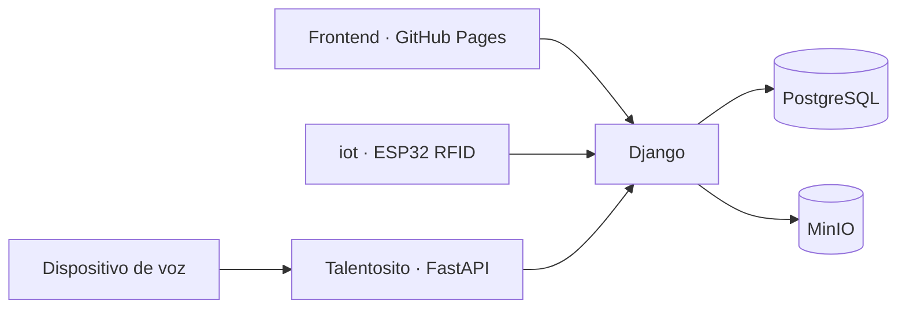

# Arquitectura del sistema — Talent Smart

## Estado y alcance

Este documento registra la arquitectura acordada para la aplicación web y su integración con la electrónica. Complementa [casos_uso_1.md](casos_uso_1.md) e [info_usuarios.md](info_usuarios.md). La separación de servicios, API Django, Compose, configuración y workflows ya cuentan con implementación en el repositorio. Las secciones siguientes conservan el contexto de diseño; las instrucciones operativas vigentes están en [ejecución dev](../../docs/ejecucion-dev.md), [despliegue qa](../../docs/despliegue-qa.md) y [contrato de API](../../docs/api.md). El despliegue real en Hostinger requiere aprovisionamiento externo y aún no se ha ejecutado.

Decisiones de implementación: rama `qa` para promoción; GHCR como registro; sesiones Bearer de 8 horas en memoria del frontend; gateway HTTP solo en loopback 9083 detrás del proxy TLS del host; RFID de iot hacia Django; Talentosito conserva FastAPI. MinIO se construye desde código fuente fijado porque las imágenes comunitarias consultadas no estaban disponibles; su repositorio upstream está archivado, como se detalla en la guía de qa.

Solo se contemplan dos ambientes: **dev**, ejecutado en la máquina local, y **qa**, publicado en GitHub Pages y Hostinger. No se define un ambiente de producción en esta etapa.

## 1. Separación de responsabilidades

| Componente | Tecnología o ubicación | Responsabilidad |
| --- | --- | --- |
| Frontend web | React, TypeScript y Vite; `frontend/` | Interfaz, navegación, formularios y consumo de las API. Publicación estática en GitHub Pages para qa. |
| Backend web | Python y Django; `backend/` | API, autenticación, autorización por rol, reglas de negocio, horarios, asistencia diaria, incidencias y reportes. |
| Datos estructurados | PostgreSQL | Usuarios, asignaciones RFID, grados, secciones, cursos, horarios, marcaciones, incidencias y metadatos de archivos. |
| Archivos | MinIO | Almacenamiento de documentos e imágenes; el backend controla quién puede subirlos o descargarlos. |
| Asistente de electrónica | `talentosito/` (antes `asistente/`) | Procesamiento de voz y comunicación con el dispositivo electrónico, manteniendo su integración con la aplicación web. |
| Capa IoT RFID | `iot/`: firmware para ESP32/ESP32-C6, RC522, HC-SR04 y servo | Envía lecturas y estado directamente a Django; se compila y carga en la placa. Sin web, base local ni Docker. |

El frontend se comunica con Django mediante HTTPS en qa. No accede directamente a PostgreSQL ni recibe credenciales de MinIO. Django es la autoridad sobre permisos y reglas de negocio, incluidos los accesos originados desde Talentosito o desde la electrónica.

Se propone que las cargas y descargas de archivos pasen inicialmente por Django, con almacenamiento privado en MinIO. Así no es necesario publicar la API de MinIO ni su consola al navegador. Los archivos estáticos del frontend y los archivos subidos por los usuarios son recursos distintos.

## 2. Integración con Talentosito y RFID

El cambio de nombre de `asistente/` a `talentosito/` se realizó junto con los ajustes de firmware, pruebas, documentación y workflows.

El asistente actual utiliza FastAPI y ofrece `/ask` y `/transcribe`. Se propone conservar inicialmente ese servicio de voz como componente independiente; las nuevas API de la aplicación web se implementarán con Django. El cambio de nombre no implica por sí mismo una reescritura del procesamiento de audio.

Flujo objetivo:

1. El dispositivo envía el audio a Talentosito y recibe la respuesta de voz.
2. Cuando la consulta requiere información escolar, Talentosito consulta la API de Django con autenticación de servicio y un contexto de usuario validado.
3. Django verifica el alcance de ese usuario antes de devolver información. Un identificador enviado libremente por el dispositivo no basta para autorizar la consulta.
4. Las marcaciones RFID llegan a Django, que identifica al estudiante, conserva la lectura y consolida su asistencia diaria.

Existen dos subproyectos de robótica: **Talentosito**, asistente de consultas de los estudiantes, y **iot**, capa IoT del circuito RFID. El ESP32 consume directamente la API Django y conserva el control local del servo y sensor. La gestión web pertenece a frontend/backend. iot no tiene panel, servidor, almacenamiento JSON, imagen Docker ni servicio Compose. La autorización registra asistencia diaria; no demuestra apertura física ni paso efectivo del estudiante.



Se deberá documentar el contrato de integración: rutas, autenticación, formatos de audio y mensajes, tiempos de espera, errores y reintentos. El contrato RFID deberá evitar que los reintentos dupliquen la asistencia diaria.

## 3. Ambientes

| Aspecto | dev | qa |
| --- | --- | --- |
| Frontend | Servidor Vite local, propuesto como servicio de Compose con recarga de código | Compilación estática publicada en GitHub Pages |
| Django | Contenedor local con configuración de desarrollo | Contenedor en Hostinger, servidor WSGI/ASGI y `DEBUG=False` |
| PostgreSQL y MinIO | Contenedores y volúmenes locales | Contenedores y volúmenes persistentes propios de qa |
| Talentosito | Servicio local en Compose y electrónica de prueba | Servicio en Compose en Hostinger, con acceso configurado para la electrónica |
| iot | Firmware con IP LAN de Django; carga local por USB | Firmware con URL HTTPS de Django; carga por USB en la placa |
| Configuración | Archivo local no versionado | Archivo privado del servidor y secretos de despliegue en GitHub Actions |
| Datos y credenciales | Exclusivos de dev | Exclusivos de qa |

La publicación web en Pages corresponde a qa, aunque el trabajo de código use ramas con otros nombres. Los ambientes no deben compartir bases, buckets ni credenciales.

## 4. Contenedores y Docker Compose

Se implementaron un archivo base `compose.yaml` y ajustes `compose.dev.yaml` y `compose.qa.yaml`. El conjunto base contiene los servicios comunes; el frontend con Vite solo se incorpora en dev.

Servicios implementados: `backend`, `postgres`, `minio`, `minio-init`, `talentosito`; además, `frontend` en dev y un proxy inverso para el acceso HTTPS de qa, cuya ubicación dependerá de la infraestructura existente.

- Usar proyectos Compose separados, por ejemplo `talentsmart-dev` y `talentsmart-qa`, con redes y volúmenes propios.
- Comunicar contenedores por nombre de servicio, no por IP fija. Dentro de un contenedor, `localhost` no identifica otro servicio.
- Mantener PostgreSQL y MinIO en una red privada de datos. Django se conectará tanto a esa red como a la red de aplicación.
- Permitir a Talentosito la salida necesaria a su proveedor de voz/IA sin darle acceso directo a la base de datos.
- Incorporar comprobaciones de salud, reintentos de conexión y políticas de reinicio. El inicio de un contenedor no demuestra que el servicio esté listo.
- Persistir PostgreSQL y MinIO en volúmenes; no depender del sistema de archivos efímero de los contenedores.
- En qa, utilizar imágenes identificadas por versión o commit, sin montar el código fuente para ejecutar la aplicación.

La separación entre puertos del host y puertos internos, así como la resolución por nombre de servicio, sigue el modelo de [redes de Docker Compose](https://docs.docker.com/compose/how-tos/networking/).

## 5. Hostinger, puertos y exposición

**Los puertos del host 9082, 4567 y 3307 ya están ocupados por otro servicio y no deben reutilizarse ni modificarse.** Talent Smart debe coexistir con ese servicio sin alterar sus contenedores, redes o volúmenes.

La siguiente distribución es una propuesta, no una comprobación de disponibilidad del servidor:

| Servicio | Puerto interno propuesto | Acceso en dev | Acceso en qa |
| --- | --- | --- | --- |
| Frontend Vite | 5173 | `127.0.0.1:5173` | GitHub Pages; sin contenedor frontend en Hostinger |
| Django | 8000 | `127.0.0.1:8000` | A través del proxy HTTPS; sin publicación directa general |
| Talentosito | 8000, en su propio contenedor | Puerto del host 8001; acceso LAN configurable para el ESP32 | A través del proxy HTTPS y autenticación del dispositivo |
| iot | No aplica; cliente IoT | Consume Django en 8000, sin servidor propio | Consume /api/rfid/registro mediante HTTPS, sin puerto propio |
| PostgreSQL | 5432 | `127.0.0.1:5432` para inspección local | Solo red privada de datos |
| MinIO API | 9000 | `127.0.0.1:9000` para clientes S3 locales | Solo red privada de datos |
| MinIO consola | 9001, configurado explícitamente | `127.0.0.1:9001` para administración local | Sin acceso público; administración mediante acceso restringido |

Antes de implementar qa se debe verificar que el plan de Hostinger permite Docker Engine y Compose y que se dispone de acceso administrativo al servidor. También se deben inspeccionar los puertos, el proxy y la gestión de certificados existentes.

Si ya existe un proxy HTTPS, se integrarán los dominios de Talent Smart mediante rutas a los servicios propios. Si necesita un puerto del host para alcanzar la aplicación, se propone **9083 ligado a loopback**, sujeto a verificar disponibilidad y a definir qué servicio de entrada lo utiliza. Si no existe proxy, se deberá reservar la entrada HTTPS y resolver los certificados antes de publicar; no se presupone que 80 o 443 estén libres.

La API deberá ser accesible por HTTPS desde GitHub Pages. Django permitirá explícitamente el origen del frontend mediante CORS. La configuración de autenticación entre dominios, cookies y CSRF se definirá conjuntamente; CORS no sustituye la autenticación ni la autorización. Para qa se configurarán también `ALLOWED_HOSTS`, secretos externos y cabeceras del proxy conforme a la [guía de despliegue de Django](https://docs.djangoproject.com/en/5.2/howto/deployment/checklist/).

## 6. Configuración y secretos

Estructura propuesta:

```text
backend/
  config/settings/base.py
  config/settings/dev.py
  config/settings/qa.py
  Dockerfile
  .dockerignore
talentosito/                 # Antes asistente/
  Dockerfile
  .dockerignore
  secrets.example.h         # Plantilla del firmware, sin credenciales reales
iot/
  iot.ino
  esp32.cpp
  pins.h
  secrets.example.h
frontend/
  .env.example              # Solo configuración pública
deploy/
  env/dev.env.example
  env/qa.env.example
compose.yaml
compose.dev.yaml
compose.qa.yaml
docs/
  ejecucion-dev.md
  despliegue-qa.md
```

Las plantillas se versionarán con valores ficticios y explicación de cada variable. Los archivos reales, como `deploy/env/dev.env` y el archivo de qa alojado fuera del checkout en Hostinger, se excluirán de Git y de los contextos de construcción de imágenes. No se incluirán secretos en Dockerfiles, imágenes, logs ni artefactos del frontend.

| Configuración | Ejemplos de variables | Tratamiento |
| --- | --- | --- |
| Frontend | `VITE_API_BASE_URL` | Pública; apunta a localhost en dev y a la API HTTPS de qa al compilar para Pages |
| Django | `DJANGO_SETTINGS_MODULE`, `DJANGO_SECRET_KEY`, `DJANGO_ALLOWED_HOSTS`, `CORS_ALLOWED_ORIGINS` | Secretos y opciones inyectados en tiempo de ejecución; los nombres deberán mapearse a los settings correspondientes |
| PostgreSQL | `POSTGRES_DB`, `POSTGRES_USER`, `POSTGRES_PASSWORD`, host y puerto internos | Credenciales independientes por ambiente |
| MinIO | Endpoint interno, bucket, credenciales administrativas y credenciales de aplicación | La aplicación usará permisos limitados al almacenamiento que necesita |
| Talentosito | `GROQ_API_KEY`, URL interna de Django, credencial de servicio | Exclusivas del servidor; no incorporadas al frontend ni al firmware |
| Electrónica | URL del servicio, Wi-Fi y credencial de dispositivo | Configuración privada separada del código versionado |
| Despliegue | Host, usuario, puerto y clave SSH; huella del servidor; acceso al registro de imágenes | Secretos o variables del entorno de despliegue, según su sensibilidad |

Las variables `VITE_*` quedan expuestas en el código compilado; no se utilizarán para contraseñas o claves privadas. Cambiar la URL de API de ese mecanismo exige recompilar el frontend. Véase [configuración de entornos de Vite](https://vite.dev/guide/env-and-mode).

Al implementar Compose, se distinguirá el archivo usado para interpolar variables con `--env-file` de las variables realmente entregadas a cada contenedor mediante `environment`, `env_file` o secretos montados. Cada servicio recibirá únicamente la configuración que requiere.

El `.gitignore` ya permite versionar `.dockerignore` y las plantillas de `deploy/env/`, y excluye los archivos privados `*.env` y `.env.*`. Los Dockerfiles utilizan contextos separados y sus propias exclusiones.

## 7. Despliegue de qa con GitHub Actions

Se implementó un flujo que coordina la publicación del backend y Talentosito en Hostinger y del frontend en GitHub Pages.

1. Obtener el código y ejecutar las verificaciones de frontend, Django y Talentosito.
2. Construir las imágenes del backend, Talentosito, MinIO y su cliente, identificadas con el commit, y publicarlas en GHCR.
3. Acceder al servidor con una cuenta de despliegue dedicada y verificación de la identidad SSH del host.
4. Actualizar únicamente el proyecto Compose `talentsmart-qa`, usando la configuración privada ya provisionada en Hostinger.
5. Comprobar las dependencias, realizar una copia de respaldo antes de migraciones y ejecutar las migraciones de Django de forma controlada, sin lanzarlas en paralelo desde cada instancia.
6. Actualizar los servicios y comprobar su salud y conectividad externa. Un fallo impedirá continuar con la publicación del frontend.
7. Compilar el frontend con la URL pública de la API de qa y publicar `frontend/dist` en Pages.
8. Verificar el acceso desde Pages, la autenticación, la consulta de datos, el almacenamiento de archivos y la comunicación de la electrónica.

Se evitarán despliegues simultáneos de qa. El despliegue conservará volúmenes y servicios ajenos; no ejecutará limpieza global de Docker ni eliminará volúmenes para actualizar la aplicación. La API deberá mantener compatibilidad con el frontend anterior durante la actualización, ya que ambas publicaciones no son atómicas.

Se definirán el entorno `qa` de Actions para Hostinger y las variables/secretos que requiera. El trabajo de publicación de Pages conservará su entorno `github-pages`; las variables públicas necesarias se configurarán también en el trabajo que compila el frontend. Los secretos de un entorno solo están disponibles para los trabajos que lo referencian, según la [documentación de entornos de GitHub Actions](https://docs.github.com/en/actions/how-tos/deploy/configure-and-manage-deployments/manage-environments).

El workflow `.github/workflows/deploy-pages.yml` ahora es reutilizable, compila desde `frontend/` con su lockfile y publica `frontend/dist`. Lo invoca `deploy-qa.yml` después de verificar Hostinger; solo la rama `qa` promueve este ambiente. `ci.yml` valida los cambios de `main`, `dev` y los pull requests sin publicar.

La reversión deberá identificar la imagen anterior, el artefacto del frontend y la compatibilidad de las migraciones. Volver a una imagen anterior no revierte automáticamente los cambios de base de datos.

## 8. Documentación operativa requerida

Las siguientes guías ya están incluidas en `docs/`; este documento conserva sus requisitos de cobertura. La validación local no sustituye las pruebas en el servidor Hostinger y en la electrónica física.

**`docs/ejecucion-dev.md`** deberá incluir:

- Requisitos para Windows y/o Linux, versiones verificadas de Docker y Compose y herramientas de la electrónica.
- Creación de la configuración privada desde las plantillas, construcción y arranque de Compose.
- Migraciones, creación inicial del administrador y carga de datos de prueba.
- URLs y puertos, recarga de código, ejecución de pruebas, lectura de logs y apagado conservando datos.
- Conexión del ESP32: IP LAN del equipo, puertos y firewall. `localhost` en el dispositivo no apunta a la computadora.
- Un procedimiento separado y explícito para restablecer exclusivamente los datos locales de prueba.

**`docs/despliegue-qa.md`** deberá incluir:

- Preparación de Hostinger, comprobación de los puertos ocupados 9082, 4567 y 3307, dominio, TLS, proxy y directorios propios.
- Instalación de Docker/Compose y aprovisionamiento de configuración, volúmenes, cuenta de despliegue y acceso al registro de imágenes.
- Configuración de GitHub Actions y GitHub Pages, disparadores y secuencia de primer despliegue y actualizaciones.
- Migraciones y creación inicial del administrador sin credenciales predeterminadas en el repositorio.
- Comprobaciones de salud, logs, diagnóstico de CORS y conexión con Talentosito/RFID.
- Respaldo y restauración de PostgreSQL y MinIO, permisos y metadatos de archivos, conservación de secretos y procedimiento de reversión.
- Reinicio y apagado solo del proyecto qa, preservando los datos y el servicio existente.

Cada guía deberá contener comandos comprobados desde un checkout limpio, resultados esperados y solución de errores frecuentes. Las instrucciones de qa deberán probarse en el servidor destinado a ese ambiente antes de considerarse terminadas.

## 9. Decisiones técnicas pendientes

- Confirmar las capacidades y recursos del servidor Hostinger, los puertos disponibles y el proxy HTTPS existente.
- Configurar los dominios reales y las credenciales de qa; el mecanismo web ya utiliza sesiones Bearer.
- Revisar la continuidad de MinIO comunitario archivado; las imágenes de esta implementación se construyen desde versiones fijadas.
- Compilar y verificar en dispositivos físicos el firmware RFID de `iot/`, y definir el emparejamiento de sesiones personales de Talentosito. Django ya dispone de la API RFID y la voz tiene autenticación de dispositivo/servicio.
- Definir la retención y destino externo de respaldos, y ensayar restauración/reversión con los datos reales de qa.
